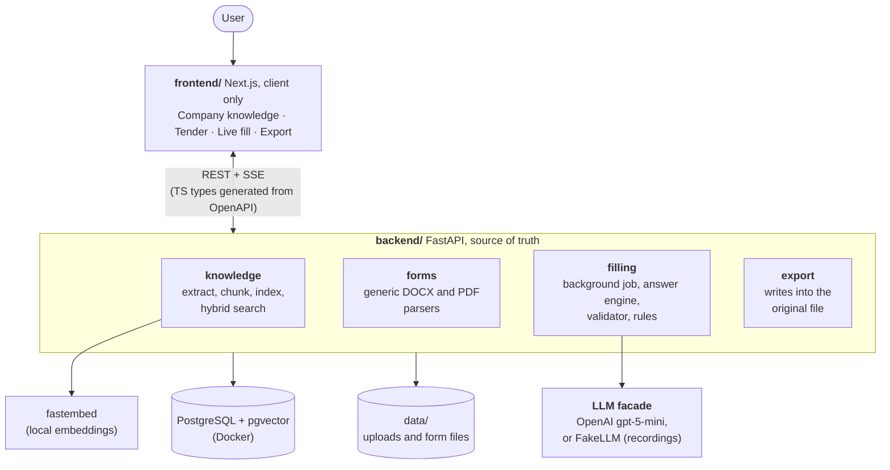

# Formpilot — AI form filler for tenders

Buyers in public tenders send forms that bidders must fill in: company details, insurance, tax and legal declarations. Doing it by hand takes hours, although most answers already exist in the company's documents.

Formpilot fills these forms from the company's documents, live and field by field. Every answer shows its source, doubts are named instead of hidden, and nothing is invented. The user only deals with what needs them, then downloads the form in its original format and layout.

Built as a technical test for Sealio, on two real forms from a Swiss public tender (`forms/`): **Annex 4** in Word (49 fields) and **Annex 7** in PDF (10 fields). The tender (Cloud Platform Services – Canton of Zurich) and the bidder (Alpenlogic AG) are fictitious.

## Quick start

**You need:** [Docker](https://www.docker.com/) (port 5432 free), [uv](https://docs.astral.sh/uv/) (it fetches Python 3.14), Node 26 (`.nvmrc`) and pnpm 12 (through corepack).

```bash
fnm use                # or: nvm use
corepack enable pnpm
make install           # back and front dependencies
make dev               # db + API on :8000 + UI on :3000 (Ctrl-C stops the API and the UI)
```

Open <http://localhost:3000>. Migrations and the seed (tenant, tender, both forms) run when the API starts. `make db-stop` stops the database.

**No API key is needed.** By default the app replays real model answers recorded in `backend/llm_recordings/`, at their recorded speed. They were recorded on the demo documents, so add those first. Answers are still checked against your indexed documents.

The first document you add downloads the embedding model (~100 MB, into `~/.cache/fastembed`), then everything but the model calls runs offline.

### With the real model

```bash
cp backend/.env.example backend/.env
```

Set both values in `backend/.env`, then restart the API:

```bash
FORMPILOT_LLM_PROVIDER=openai
OPENAI_API_KEY=sk-...
```

A fill costs about $0.06 for Annex 4 and less than $0.01 for Annex 7. All settings are in `backend/app/core/config.py`.

## Demo in five steps

1. **Company knowledge** starts empty. Drop the 11 files of `knowledge-base/documents/` on the page (or use *Add documents*) and wait for *Indexed*. Click a document to preview it.
2. **Tender**: click *Auto-fill* on Annex 4, check the summary in the Setup dialog, then *Start*.
3. **Live fill**: answers appear one by one on the document, each validated before it is shown. You can already edit any field.
4. **Review**: the queue lists doubts first (*To check*), then fields without a value, then automatic answers (collapsed). Keep or choose a value, enter one, or leave the field empty. *Source* opens the cited document at the quote, highlighted.
5. **Export**: it warns about what nobody settled, but never blocks. Download the DOCX (or the PDF for Annex 7). Signature and stamp stay empty, to be done by hand.

Annex 4 is the more interesting one: its documents hold conflicts, an expired certificate and missing information on purpose (`knowledge-base/GROUND_TRUTH.md`). The floating *Reset demo* button (dev only) brings everything back to step 1.

## Architecture



- **The back holds all the logic.** Field statuses, review order and counters are computed there; the front only displays them.
- **The critical parts are pure functions** (parsers, validator, rules, exporters): data in, data out, no database or network. That is what makes them easy to test.
- **Fill events are stored in the database**, and the SSE stream reads them back. Reloading the page replays the run.
- **Only `app/llm/` imports the OpenAI SDK**, so changing provider touches one adapter.

Details, module rules and data model: [`docs/ARCHITECTURE.md`](docs/ARCHITECTURE.md), [`docs/DB_SCHEMA.md`](docs/DB_SCHEMA.md).

## How answers stay reliable

The model proposes; the code decides what reaches the form.

1. **Search**: for each field, hybrid search (vectors + full text, fused by RRF) finds the top 8 passages. Full text catches IDs and policy numbers, vectors catch rewordings.
2. **Ask**: one call per group of fields (a form section, split beyond 10 fields), groups in parallel. The model must return values with exact quotes, or nothing.
3. **Ask twice**: each call is made twice and merged, because the model does not answer the same way every time. Whatever differs becomes a visible doubt instead of a silent error.
4. **Verify**: each quote must really be in a passage from one document, and each significant word and number of the value must be in its verified quotes. If nothing survives, the field stays empty.
5. **Apply generic rules**: no rule is specific to a form or a field.

| Situation | What happens |
|---|---|
| Value with verified quotes, both runs agree | Filled automatically, source shown |
| Sources give different values | *Conflict*: the most recent is selected, both are shown, user decides |
| Expired, or source over a year old with no validity running | *Outdated*: proposed, to check |
| Found by only one of the two runs | Proposed, to check |
| Yes/No with verified evidence | Ticked, proof shown, editable |
| Yes/No without evidence, or nothing found | Left empty for the user, never guessed |
| Only the user can answer (place, date) | Suggested value, to confirm |
| Signature, stamp | Never filled |

### Measured quality

Scored field by field against the ground truth, with the real model ([`docs/EVALUATION.md`](docs/EVALUATION.md)). **Silent** means wrong and presented as sure, the only outcome a user could miss.

| Form | Fields checked | Right | Flagged to the user | Silent | Time |
|---|---|---|---|---|---|
| Annex 4 | 44 | 32 | 11 | **1** | 34 s |
| Annex 7 | 9 | 9 | 0 | 0 | 22 s |

This is **one live run per form** ($0.08 in total), so it is an indication rather than a statistic. The silent error is the exact address of the tax office. On Annex 4, the committed recordings used by the demo score better (39 right, 5 flagged, 0 silent), because one good run was picked to record: expect the real model to raise more doubts than the demo.

## Tests

| Command | What it covers | Size |
|---|---|---|
| `make test` | Back: parsers on the real forms, validator, rules, exporters (reopening the exported files), API and fill job. Front: one integration suite per screen, only the network mocked | 334 + 239 tests, ~1 min for the back |
| `make e2e` | One Playwright main scenario: documents added, both forms auto-filled, doubts settled, files downloaded. Real back with recorded answers, on its own database and ports | 1 scenario, ~30 s |
| `make test-slow` | Search recall with the real embedding model: is the passage holding each expected value found? | Downloads the model once |
| `make eval` | Recorded answers scored against the ground truth | Free |
| `make eval-live RUNS=n FORM=annex-4` | Same with the real model, then `make eval-report` to write the report | **Paid** |

No test needs an API key or the network, except `make eval-live` (and the model download for the slow tests and the e2e). Before the first `make e2e`, run `pnpm exec playwright install chromium` in `frontend/`.

Other commands: `make lint`, `make typecheck`, `make format`, `make gen-api` (front types from the running API), `make db-schema` (regenerates the schema doc, checked by a test).

## Main decisions

| Decision | Why |
|---|---|
| A generic parser and generic rules, no per-form logic | Other forms will come; the model judges each field and the code checks the proof |
| Yes/No ticked automatically when evidence is found | Fewer clicks; the proof is always visible and editable |
| Export never blocked | The user stays in charge; open points are listed, not enforced |
| No fact extraction at ingestion in V1 | Cost; conflicts and outdated sources are detected while filling |
| Answers streamed field by field, each validated before it appears | Live feedback without ever showing an unchecked answer as final |
| Exact quotes verified by code, not a confidence score from the model | A quote can be checked; a self-reported score cannot |
| PostgreSQL for both vectors and full text | One system, and fast enough at this size |
| Recorded answers replayed through `FakeLLM` | Tests and demo that are free, deterministic and need no key |
| Tender forms seeded, no user upload | In the product they come from an external source |

The interface never says "AI" (*Auto-fill*, *Filled automatically*): a product choice. The full decision log is in [`docs/PLAN.md`](docs/PLAN.md).

## Known limitations

- **An error common to both runs is not caught**: a wrong value that both runs agree on and can quote passes as sure. The merge also raises false doubts when two right answers are worded differently.
- **Evaluation is thin**: two forms, one live run each. The parsers are generic but have only met these two forms.
- **English only**: full-text search and the embedding model are English, a real limit for Swiss documents in German or French.
- **No re-fill that keeps your work**: on a started form, *Discard answers* deletes everything, your values included, before a new *Auto-fill*.
- **Word preview is an approximation** of the page (browser rendering with fallback fonts); the exported DOCX is the reference. Exports are checked structurally, not by comparing rendered images.
- **A very long value can overflow** its zone in a PDF, even at the 5 pt minimum font size.
- **A stuck model call can hold a section** for up to ~4.5 min (3 attempts of 90 s). The other sections continue, and *Retry* reruns only the failed fields.
- **Fill jobs live in the API process**: a restart marks the running fill as failed.
- **With recorded answers**, the suggested place and date are those of the recording day.

## Remaining features

Next steps, in the order we would tackle them:

1. **More reliable answers**: run the evaluation on more runs and more forms, then compare meanings rather than wording when merging runs, and reduce errors common to both runs.
2. **German and French** documents and forms, which Swiss tenders need.
3. **Re-fill that keeps the user's values**, and undo for a review decision.
4. **Learn from past work**: reuse answers entered by users and previous submissions as sources.
5. **Fact extraction at ingestion**: extracted facts in *Company knowledge*, with outdated and conflict alerts before filling, and a conflict settled once for every form.
6. **Declarations audit trail** attached to the export, and *Replace certificate* from an outdated answer.
7. **Production basics**: real login (`CurrentTenantId` is the only place to change), a durable job queue, monitoring of quality, cost and latency.
8. **Broader product**: several tenders, imported from the external source, and bulk validation of answers.
9. **Visual regression tests** of exported files against the originals.

## Repository

```
frontend/         Next.js UI                           (see its CLAUDE.md for commands)
backend/          FastAPI API, migrations, scripts     (see its CLAUDE.md for commands and settings)
forms/            the two tender forms, seeded at startup
knowledge-base/   11 demo documents, their generator, GROUND_TRUTH.md
docs/             product and technical documentation
```

| Document | Content |
|---|---|
| [`docs/USER_FLOW.md`](docs/USER_FLOW.md) | User flow, screen by screen, and business rules (French) |
| [`docs/ARCHITECTURE.md`](docs/ARCHITECTURE.md) | Global, front and back architecture (French) |
| [`docs/PLAN.md`](docs/PLAN.md) | Project plan and decision log (French) |
| [`docs/EVALUATION.md`](docs/EVALUATION.md) | Measured answer quality |
| [`docs/DB_SCHEMA.md`](docs/DB_SCHEMA.md) | Database schema, generated from the models |
| [`docs/design/`](docs/design/) | UI mockups |
