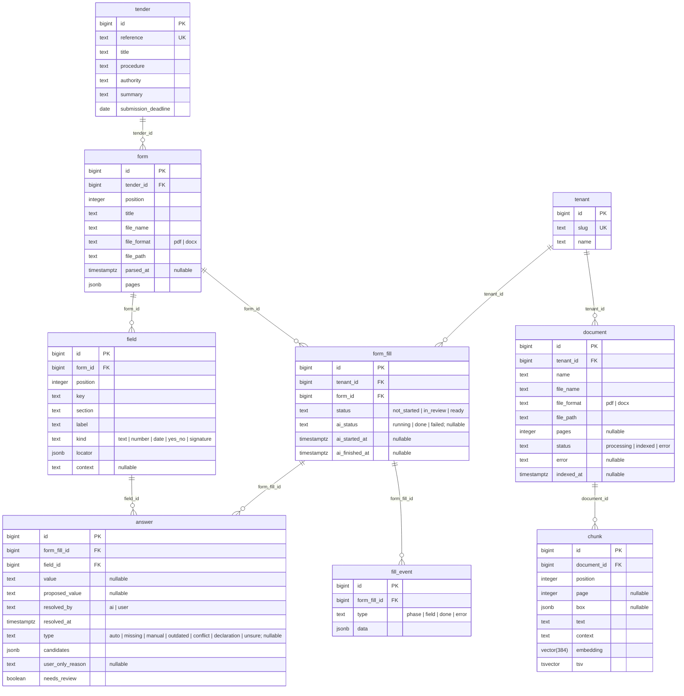

# Database schema

<!-- Generated by `make db-schema` from the SQLAlchemy models: do not edit by hand. -->

Every table also has `created_at` and `updated_at` (`timestamptz`, set by the database).
Shared reference data (tenders, forms, fields) is the same for every tenant; what a tenant
produces (`form_fill`, `answer`) carries its `tenant_id`, directly or through its fill.

## Constraints and indexes

### `answer`

- FK `field_id` → `field.id`, on delete cascade
- FK `form_fill_id` → `form_fill.id`, on delete cascade
- unique `(form_fill_id, field_id)`
- index `(field_id)`

### `chunk`

- FK `document_id` → `document.id`, on delete cascade
- unique `(document_id, position)`
- index `(embedding)`
- index `(tsv)`

### `document`

- FK `tenant_id` → `tenant.id`, on delete cascade
- unique `(tenant_id, file_name)`

### `field`

- FK `form_id` → `form.id`, on delete cascade
- unique `(form_id, key)`
- unique `(form_id, position)`

### `fill_event`

- FK `form_fill_id` → `form_fill.id`, on delete cascade
- index `(form_fill_id)`

### `form`

- FK `tender_id` → `tender.id`, on delete cascade
- unique `(tender_id, file_name)`
- unique `(tender_id, position)`

### `form_fill`

- FK `form_id` → `form.id`, on delete cascade
- FK `tenant_id` → `tenant.id`, on delete cascade
- unique `(tenant_id, form_id)`
- index `(form_id)`

### `tenant`

- unique `(slug)`

### `tender`

- unique `(reference)`
